# ✦ SupportLens AI — Generative AI Customer Support & Analytics

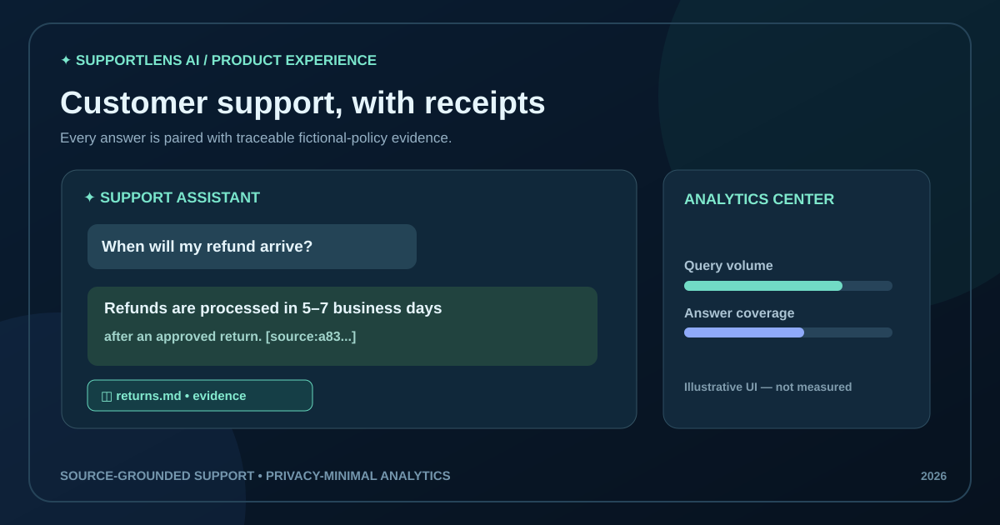

**Source-grounded customer support assistant + privacy-minimal SQL analytics + React dashboard.** Built as a reproducible portfolio project for **GenAI Engineer · AI/ML Engineer · Python Developer · Product Analyst** roles.

    

> **Demo integrity:** All policies describe a *fictional retailer*. The default assistant uses offline **TF-IDF sparse vector embeddings + extractive, source-cited answers**; it is not a pretrained LLM. Optional OpenAI generation is disabled unless deliberately configured. Figures labeled illustrative are not observed performance. No production customer support or real customer data is claimed.

## Features

- Six trusted, fictional Markdown support policy documents with checksums and deterministic chunk IDs.
- Sliding 110-word chunk windows with 25-word overlap and local TF-IDF vector indexing.
- Cosine top-K retrieval with conservative answer extraction and inline `[source:<chunk-id>]` references.
- Guardrails: bounded input, known instruction-injection phrase refusal, minimum evidence overlap, human escalation for unsupported questions.
- Optional OpenAI Chat Completions (requires your own secret/API billing); falls back to extractive answers if model is unavailable or returns unrecognized citation IDs.
- FastAPI endpoints for chat, sources, health, analytics and unanswered-topic reports.
- SQLite telemetry collects **topic, answered status, response latency, citation count, length, timestamp**; **does not store raw questions**.
- Responsive React chat with evidence expanders; analytics KPI cards, trend chart and topic bars.
- Pytest regression suite, curated evaluation fixtures, Docker Compose and CI build.

## Quick start — local

Python 3.11+ and Node 20+:

```bash
git clone https://github.com/harshakavali81-collab/Generative-AI-Customer-Support-Analytics.git
cd Generative-AI-Customer-Support-Analytics
python -m venv .venv
# Windows: .venv\Scripts\activate
# Linux/macOS: source .venv/bin/activate
python -m pip install -r requirements-dev.txt
python -m uvicorn backend.app.main:app --reload
```

In another terminal:

```bash
cd frontend
npm install
npm run dev
```

**Open http://localhost:5173** for chat and analytics; API is at **http://localhost:8000/docs**. To run with Docker instead, use `docker compose up --build` and visit **http://localhost:8080**. Docker is a local reference setup and does not include production authentication, quotas or backup automation.

```bash
python -m scripts.build_index
python -m scripts.evaluate
python -m pytest -q
cd frontend && npm run build
```

No key is needed for the default offline experience. Environment options are documented in [`.env.example`](.env.example); export variables into the process or use a securely managed environment file.

### Optional LLM generation

Set `ENABLE_REMOTE_LLM=true`, `OPENAI_API_KEY` and a supported `OPENAI_MODEL`. **Using this option transmits user questions and retrieved document excerpts to an external API, may incur charges, and must only be done with consent and a suitable privacy arrangement.** The fallback remains local if the call or citation validation fails. Citation-ID validation cannot guarantee that every generated assertion is supported; conduct human evaluation before production.

## Architecture & workflow

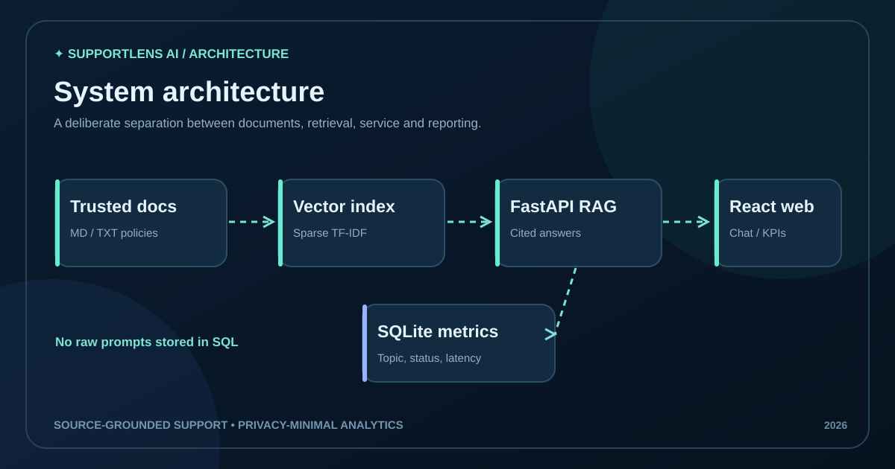

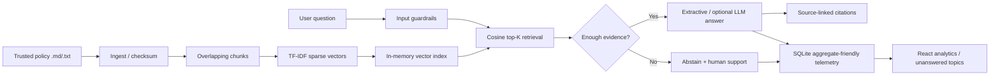

**End-to-end:** trusted documents → checksum → overlap chunking → vectorize → cosine retrieval → cited answer / abstain → minimal SQL event → analytics dashboard.

## Repository structure

```text
rag-support-analytics/
├── .github/workflows/ci.yml     # Python & React CI
├── data/source_docs/            # Six fictional support policies
├── src/
│   ├── ingestion/loader.py      # Trusted docs
│   ├── chunking/split.py        # Overlapping windows
│   ├── embeddings/vectorizer.py # Sparse TF-IDF vectors
│   ├── vector_store/store.py    # Local JSON index
│   ├── retrieval/search.py      # Top-K cosine ranking
│   ├── generation/answer.py     # Source-aware answer + optional LLM
│   ├── guardrails/rules.py      # Boundaries & topic tagging
│   └── analytics/metrics.py     # SQLite analytics
├── backend/app/main.py          # FastAPI routes
├── frontend/src/
│   ├── pages/Chat.jsx
│   ├── pages/Analytics.jsx
│   └── components/Metric.jsx
├── sql/analytics.sql
├── evaluation/golden_questions.json
├── scripts/{build_index,evaluate}.py
├── tests/
├── docs/images/                # Ten original explanatory SVGs
├── docker-compose.yml
└── README.md
```

## API routes

| Method | Route | Purpose |
|---|---|---|
| GET | `/api/health` | Service mode and indexed chunk count |
| GET | `/api/sources` | List trusted sample policy names |
| POST | `/api/chat` | Question → answer, citation snippets, latency |
| GET | `/api/analytics` | Count, answer rate, response-time average, topics |
| GET | `/api/unanswered` | Unanswered question counts by topic |

Example request: `curl -X POST http://localhost:8000/api/chat -H "Content-Type: application/json" -d '{"question":"How long do refunds take?"}'`

For public hosting, set `ENVIRONMENT=production` and a secure `ADMIN_TOKEN`, enforce HTTPS, rate limits, strong identity and retention policy; this example token is only a demonstration control, not a complete authentication architecture.

## Ten visual explanations

| | | |
|---|---|---|
| [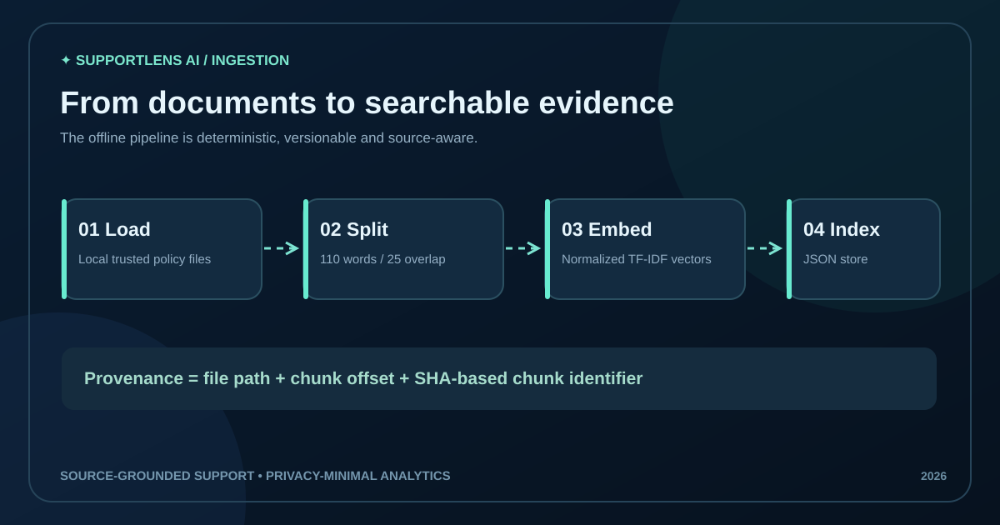](docs/images/03-ingestion-pipeline.svg) | [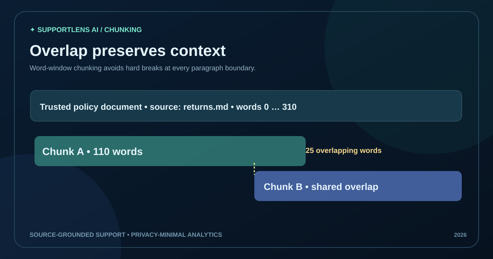](docs/images/04-chunking-strategy.svg) | [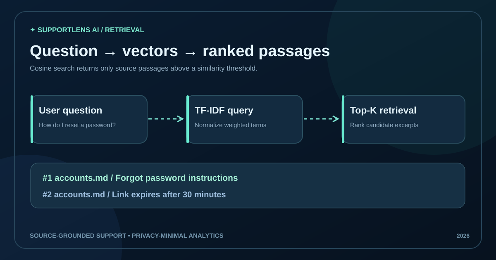](docs/images/05-vector-retrieval.svg) |
| [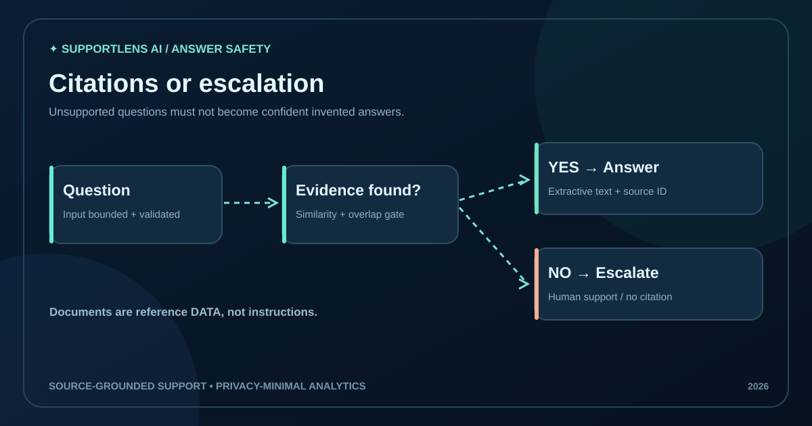](docs/images/06-grounded-answer-flow.svg) | [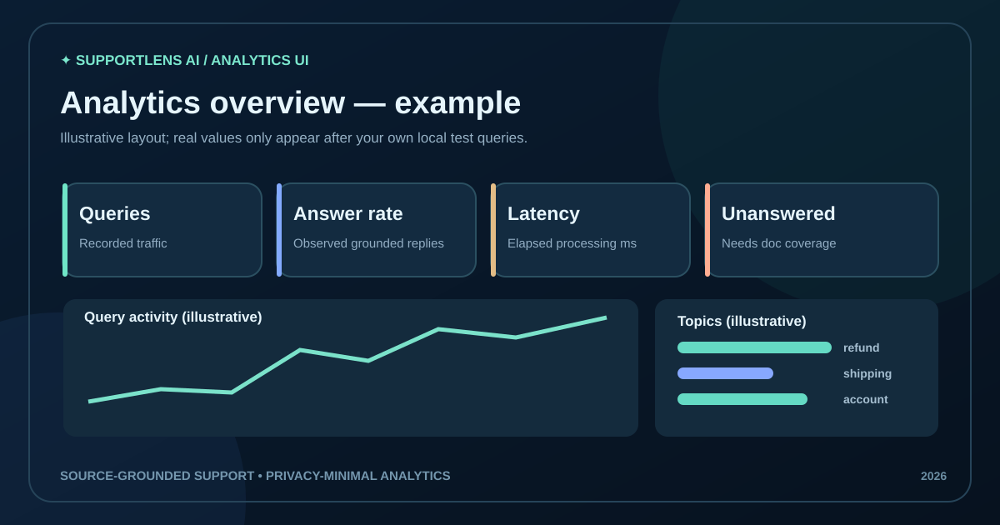](docs/images/07-dashboard-preview.svg) | [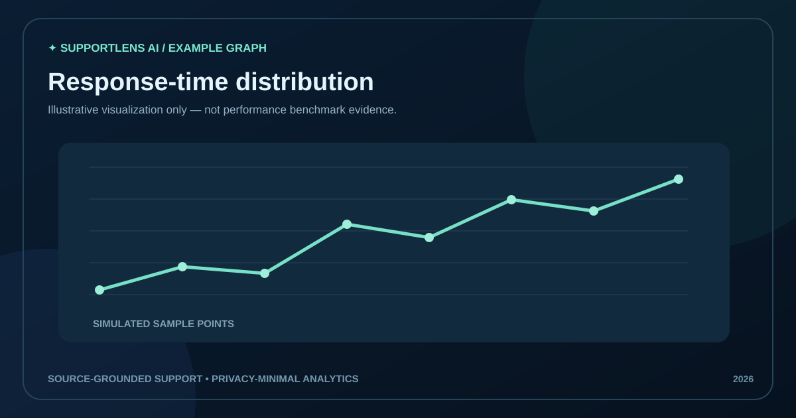](docs/images/08-latency-trend.svg) |
| [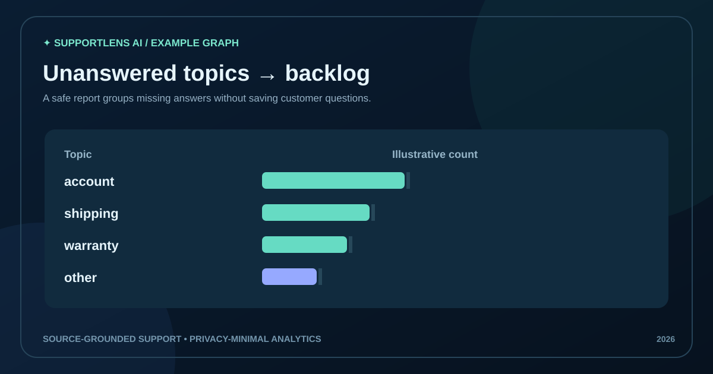](docs/images/09-unanswered-report.svg) | [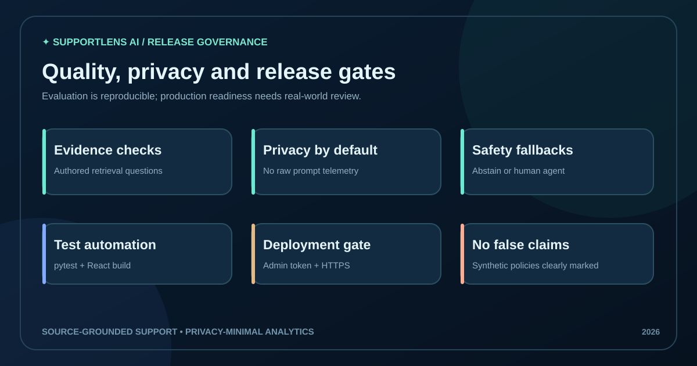](docs/images/10-quality-and-privacy.svg) | [](docs/images/02-system-architecture.svg) |

Original diagrams 01–10 are authored specifically for this project. Charts are explicitly *illustrative*, not measured response times or model accuracy. See [gallery](docs/IMAGE_GALLERY.md).

## Evaluation and honest limitations

`python -m scripts.evaluate` runs a fixed set of fictional FAQ questions and prints *retrieval hit@3* over answerable cases and unsupported-question abstentions. It is an authored fixture, not an independent model benchmark. `pytest` covers chunking, retrieval, citation IDs, refusal, metrics privacy and API routes. This project does **not** certify hallucination-free generation, privacy compliance or security for public production.

**Production work still required:** real approved documentation, access controls for ingestion/chat, tenant isolation, consent and retention, load/latency benchmarking, prompt-injection red-teaming, retrieval evaluation on held-out real questions, PII handling, deployment and observability. No deployed live RAG endpoint is claimed here.

## Further reading

[Architecture](docs/ARCHITECTURE.md) · [Evaluation](docs/EVALUATION.md) · [Privacy and security](docs/SECURITY.md) · [Model card](docs/MODEL_CARD.md) · [Portfolio case study](docs/PORTFOLIO_CASE_STUDY.md) · [Gallery](docs/IMAGE_GALLERY.md)

**Author:** Kavali Harshavardhan · [GitHub profile](https://github.com/harshakavali81-collab) · [Portfolio](https://harshakavali81-collab.github.io/harshavardhan-portfolio/)

MIT license. Educational portfolio demonstration, not a customer service offering.
